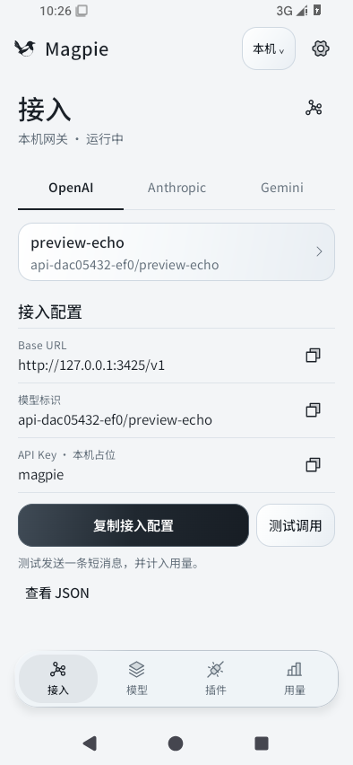

# Magpie Android

Magpie 的独立安卓移植版。当前为 **2.0.0-preview4**，内置 Magpie 核心 **v0.1.4342**。

**[下载手机 ARM64 APK](https://raw.githubusercontent.com/yvichyi/magpieA-/c34051fbf007c12cc5c5b3c77baddaa28db4b855/Magpie-Android-2.0.0-preview4-arm64.apk)** · [全部安装包与校验文件](https://github.com/yvichyi/magpieA-/releases/tag/v2.0.0-preview4)

[安装和使用](android/README.zh-CN.md) · [排版截图与验收](android/docs/preview-2.0-type/README.md) · [预览 1 页面实拍](android/docs/preview-2.0/README.md)

接入、模型、插件和用量各有底栏入口。接入可生成并测试三种兼容协议的配置。用量包括趋势、Token 构成、分布、月历和请求明细，可按筛选条件导出 CSV。设置可搜索，并提供降低透明度和减少动效选项。

## 完整源码与构建

```sh
git clone --branch v2.0.0-preview4 --depth 1 --recurse-submodules --shallow-submodules https://github.com/yvichyi/magpieA-.git
cd magpieA-
bash android/build.sh
```

核心固定为 [yetone/magpie v0.1.4342](https://github.com/yetone/magpie/tree/593517bf00bc8b0ab00c8ddef3f4d31b310a71b8)，位于 `magpie-core` 子模块；本仓库保存完整安卓宿主、资源、测试和构建配置。下载ZIP时，构建脚本会自动获取该固定核心；也可先执行 `bash android/fetch-core.sh`。工具链和签名设置见安卓说明。

原项目公开分发的OAuth客户端配置保留在其上游核心中。本仓库通过固定依赖构建同一核心。

GitHub Actions 的 Android APK 工作流支持两个架构，需按说明配置签名Secret。签名私钥不在源码中；本次发布提供已完成本地签名和验证的安装包下载链接。

[](android/docs/preview-2.0/README.md) [](android/docs/preview-2.0/README.md)

原项目及许可：[yetone/magpie](https://github.com/yetone/magpie)、[LICENSE](LICENSE)、[THIRD_PARTY_NOTICES](THIRD_PARTY_NOTICES)。
