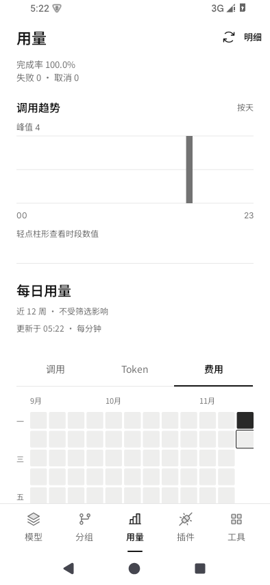

# Magpie Android

Android **1.12.0 / code13**，内置 Magpie 核心 **v0.1.4342**。独立安卓移植版。

**[下载手机 ARM64 APK](https://github.com/yvichyi/magpieA-/releases/download/v1.12.0-android/Magpie-Android-1.12.0-arm64.apk)** · [全部安装包与校验文件](https://github.com/yvichyi/magpieA-/releases/latest)

[安装和使用](android/README.zh-CN.md) · [实际验证范围与限制](android/VERIFICATION.md)

本轮新增原生近12周统计日历，支持调用、Token、费用与按日查看；修复重试统计、旧安卓编码接口和连接失败页返回。已实测同证书覆盖升级、插件链路、三种协议、小屏与大字体。实体机及部分内嵌管理页仍待完整验收，原有软件WebView限制未确认消除。

## 完整源码与构建

```sh
git clone --recurse-submodules https://github.com/yvichyi/magpieA-.git
cd magpieA-
bash android/build.sh
```

核心固定为 [yetone/magpie v0.1.4342](https://github.com/yetone/magpie/tree/593517bf00bc8b0ab00c8ddef3f4d31b310a71b8)，位于 `magpie-core` 子模块；本仓库保存完整安卓宿主、资源、测试和构建配置。下载ZIP时，构建脚本会自动获取该固定核心；也可先执行 `bash android/fetch-core.sh`。工具链和签名设置见安卓说明。

原项目公开分发的OAuth客户端配置保留在其上游核心中。本仓库通过固定依赖构建同一核心。

GitHub Actions 的 Android APK 工作流支持两个架构，需按说明配置签名Secret。签名私钥不在源码中；本次Release是已完成本地签名和验证的安装包。



原项目及许可：[yetone/magpie](https://github.com/yetone/magpie)、[LICENSE](LICENSE)、[THIRD_PARTY_NOTICES](THIRD_PARTY_NOTICES)。
