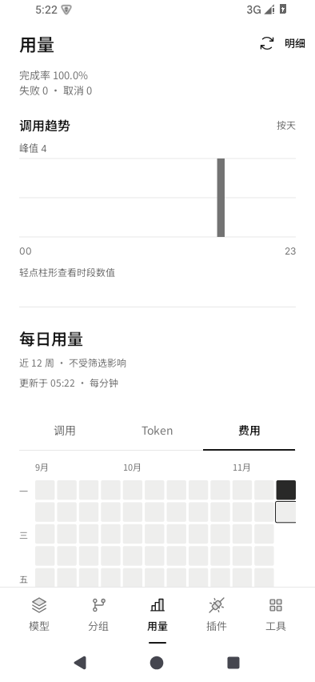
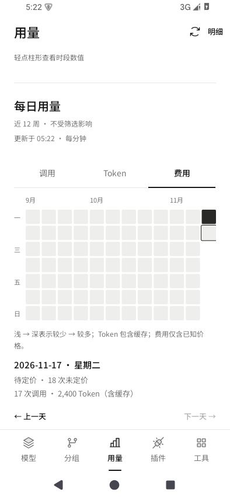

# Magpie Android 2.0 预览 1

采用 Magpie Go 网关和原生安卓界面的独立移植版。[上游项目](https://github.com/yetone/magpie) · [页面实拍](docs/preview-2.0/README.md) · [验证记录](docs/preview-2.0/VERIFICATION.md)

## 获取完整源码

原版核心固定为 `magpie-core` Git子模块，提交 `593517bf00bc8b0ab00c8ddef3f4d31b310a71b8`（v0.1.4342）。使用以下方式取得包括核心在内的全部源码：

```sh
git clone --branch v2.0.0-preview1 --depth 1 --recurse-submodules --shallow-submodules https://github.com/yvichyi/magpieA-.git
cd magpieA-
```

下载ZIP时，先运行 `bash android/fetch-core.sh`；`android/build.sh` 也会在缺少核心时自动获取同一固定提交。可用 `CORE_SOURCE_DIR` 指定已有核心源码目录。GitHub构建会递归检出子模块；Go版本与依赖缓存读取 `magpie-core/go.mod` 和 `go.sum`。

核心源码完整保留在上游子模块中，安卓代码直接保存在本仓库；这样后续同步上游也有明确版本来源。发布的APK使用前述已验收核心。完整开发快照的原始验证记录仍见下文。

## 安装

ARM64 手机选择 `arm64.apk`，x86_64 模拟器或设备选择 `x86_64.apk`。最低 Android 9.0（API 28）。同签名的 1.12 可直接覆盖升级。高级管理页面需要较新的 Android System WebView 或 Chrome。[安装包与校验文件](https://github.com/yvichyi/magpieA-/releases/tag/v2.0.0-preview1)

打开应用后，本机网关自动启动。Android 13 及以上会请求通知权限，以便显示运行状态和停止入口。第一次启动会初始化配置和模型目录；状态变为「运行中」后进入管理界面。无需电脑、Termux 或 root 即可使用 API Key 网关功能。

## 第一次使用

1. 在「模型」点「添加服务商」，选择接口协议并填写服务商 Base URL 和 API Key。无需密钥的自托管服务可留空 Key。
2. 点「读取模型」，在真实返回的列表中筛选、勾选。默认全选；也可不读取，直接填写已知的模型 ID。读取完成后会收起键盘并显示选择列表，预览不会保存服务商。
3. 点「保存并查看模型」返回模型目录。选择模型行查看模型详情，点「查看全部」恢复完整列表。
4. 在「接入」选择 OpenAI、Anthropic 或 Gemini，以及要调用的模型或分组。可分别复制地址、模型标识和密钥，或复制整份配置。点「测试调用」即可查看实际响应。
5. 在「模型 → 分组」建立模型分组。高级管理和订阅登录位于右上角「设置」。用量明细和 CSV 导出位于「用量 → 请求」。

应用不附赠厂商账号、密钥或付费额度。以下只是初始默认接入值，实际地址以模型接入面板为准：

```text
OpenAI Base URL:      http://127.0.0.1:3425/v1
Anthropic Base URL:   http://127.0.0.1:3425
Gemini Base URL:      http://127.0.0.1:3425
本机 Gateway API Key: magpie
模型 ID:              从列表复制完整模型或路由标识
```

默认本机调用遵循原版网关的本机访问规则。向局域网共享时，请在网关设置中开启共享，并创建命名网关密钥与额度限制。

## 1.12 更新

核心同步至上游稳定版 **v0.1.4342**（`593517bf00bc8b0ab00c8ddef3f4d31b310a71b8`）。包含 GitHub 插件页面识别、插件请求无响应头时超时结束、连接型插件结果合并、`free:` 免费模型分组、排队测试状态、Key 余额和 Gemini 高推理级别等上游修复。平台专属功能仍受 Android 环境限制。

原生用量页新增黑白灰的近 12 周日历，可切换调用、Token 和费用，点击日期或用「上一天 / 下一天」查看详情。日历独立于上方统计范围和模型搜索，每分钟更新，也能手动重试；读取失败保留同空间已有结果，切换空间后拒收旧结果。日历 Token 遵循原版账本，**包含缓存**；上方概览 Token 仍为输入 + 输出。未知价格明确显示未定价。

连接失败页现在直接返回原入口，保留查询与添加草稿；失败页面的晚到加载回调不会重新阻塞返回。

版本与核心统一在 `android/version.properties`；构建同时生成 APK 元数据和界面版本，避免只改版本名称。沿用交付包签名，APK 支持覆盖升级。实际验收范围见 [VERIFICATION.md](VERIFICATION.md)。

## 1.11 核心同步与统一导航

核心同步上游稳定版 **v0.1.4318**（`e25210b6e4f77dadd4be4277eba9b14b76e42b93`），两个架构均重新编译；Bun 保留校验过的官方 Android1.4.2运行时。

- 底栏固定为「模型 / 分组 / 用量 / 插件 / 工具」。工具是可搜索的完整目录，网关、资料库、设置备份和运行诊断各有直接入口。
- 模型分组与请求路由分别命名。新建、编辑分组直接进入正确的分组编辑器。
- 详情标明来源，返回原入口；高级添加返回保留原生草稿，离开到其他底栏入口前确认丢弃。
- 用量页顶部直接进入请求明细与导出；搜索与排序在切换底栏后保留。工具搜索按工作空间保留。
- 插件提供的独立页面从当前工作空间读取并出现在工具目录；切换空间时旧请求失效。电脑 Agent/会话入口直接引导远程连接。

## 1.10 功能显示与小屏排版

- 底部常驻「模型 / 路由 / 用量 / 插件 / 功能」，高级添加、资料库、网关、设置备份和诊断从「功能」进入；打开功能菜单保留当前目录搜索与筛选。
- 修正手机适配误隐藏插件顶部选项；资料库、设置和网关操作保留文字、允许换行。显式隐藏的功能仍尊重原版状态。
- 修正Token总量曾被嵌套布局压成1像素宽而漏显的问题。长服务商名称使用完整一行区域，数量与编辑另起一行；网关状态和模型读取按钮在空间不足时分行；接入按钮按实际文字宽度分行。
- 接入面板在操作区会挤占字段时自动整体滚动；常规窗口仍固定显示操作按钮。高级表单在短窗口整体滚动；管理错误说明与重试按钮可滚动。键盘弹出时暂时收起底部导航，为输入和表单留出空间。
- 保留真实添加、模型预览/保存、路由、三协议调用测试、用量检索和插件安装反馈。依赖电脑 CLI 或外部程序的原版功能仍需相应运行环境。

## 1.9 排版与实际接口测试

- 接入面板的标题和操作区固定，地址、模型和密钥可分别复制。按当前所选 OpenAI / Anthropic / Gemini 协议发起一次短消息测试；这是实际网关调用，会计入用量。测试期间重复点击不会重复发起，结果显示响应、HTTP限额/权限问题或超时，不会自动重试。
- 用量页可按模型名或服务商搜索，按调用或Token排序；这些操作只改变列表，不改变时段总计。刷新保留正在输入的搜索框，重建页面恢复查询和排序。
- 模型名和服务商占完整行，数值独立排列；大字体或过长数值采用标签在上、数值换行，避免挤掉信息。目录筛选显示匹配数/总数。
- 普通API添加、收藏、路由和高级管理仍沿用已验证路径。实际厂商/实体手机与长期后台的未验收项见 VERIFICATION.md。

## 1.8 常用模型与快捷接入

- 首页底部固定「接入客户端」，模型很多时也不必滚动到底。
- 原生选择器按名称、服务商或完整标识搜索；仅列出可用模型，收藏优先。
- 模型接入面板可直接收藏；列表的「更多」也可收藏、复制标识或编辑服务商。
- 首页「全部 / 仅可用 / 收藏」筛选。收藏只保存在手机，按本机或远程地址分开，不改变模型启用状态。
- 返回搜索恢复原筛选；从新增结果返回可查看全部；页面重建保留筛选和服务商定位。

## 1.7 原生添加与直接接入

- 常用 API Key 添加不再加载桌面选择页：原生地址/密钥表单、真实模型列表、筛选/全选/手动 ID、保存后直接看模型。
- 页面重建时保留内存中的草稿与进行中的读取；API Key 不写入未保存草稿的实例状态。离开未保存的表单会提示。
- 后台返回不完整、保存连接中断时显示结果待确认，提供返回模型列表核对，不会自动重复提交。HTTP 错误、空错误消息均不当作成功；展示错误时隐藏实际发送的密钥。
- 接入面板增加单独复制 API Key 和有效 JSON 配置。远程与局域网共享仍在网关选择真实访问凭据，避免把本机占位值当成远程密钥。
- 高级编辑改为占满手机内容区域，正文可滚动，保存/取消固定在底部。保持原版高级协议、插件、资料库、路由和备份入口。
- 版本1.8.0 / code9，证书沿用此前版本。新版本可覆盖安装；不要为升级而卸载手机上的旧版本。实测范围与限制见 VERIFICATION.md。

## 1.6 插件安装与手机交互修复

- 内置官方 Android Bun 1.4.2，设置核心使用 APK 安装目录中的运行时。修复旧版首次下载到可写缓存后被 Android 拒绝执行、导致所有插件安装失败的共同路径。构建校验官方压缩包与执行文件 SHA-256，许可随包保留。
- 官方运行时的 ELF Android ABI 要求 API28，因此本版最低 Android9。无需 root、Termux 或电脑来提供 Bun。
- 底栏增加「插件」，统一四个入口的图标和文字。顶层切页不再整页淡出闪白，关闭系统动画后也保留最后一次点击。
- 插件市场改成单列清单；名称16px、安装按钮至少44px。恢复被桌面侧栏样式隐藏的局部标签，插件/资料库/设置工具栏回归正常行，避免遮挡按钮。
- 安装进度与实际请求一致；失败原因留在页面，明确操作后重试。连接中断、响应不完整不再显示安装成功，也不会自动重复提交。
- 成功重试后同步刷新服务商、动态插件页面与列表，让新插件的登录入口立即可用。
- 原版插件选项、内置插件、登录流程、动态页面及详细管理继续保留。具体已测范围见 `VERIFICATION.md`。

## 1.5 界面与交互重做

- 三个主入口统一为「模型 / 路由 / 用量」；接入模型直接打开底部面板。高级管理、插件、资料库、备份和诊断从「更多」进入。
- 白色底面、黑灰文字、细线列表，不使用内容卡片。中文 Noto Sans SC 与数字 Inter 随包加载；正文 15–16sp，原生辅助文字至少 12sp，并尊重系统字体缩放。
- 搜索按需展开；模型标识、协议和当前网关地址可复制。接入面板明确区分本机占位 Key 与命名网关密钥；局域网/远程配置进入原版网关页。
- 用量以调用次数为主，Token、费用为辅；四个时间范围、可点选的真实趋势、模型费用列表、Token 明细和完整请求账本均可使用。未知价格明确显示「待定价」。
- 无变化的刷新保留列表和滚动位置。搜索展开、页面切换、时间下划线、图表和复制反馈均可取消，快速重复操作以最后一次为准；系统关闭动画时直接落到最终状态。
- 版本 1.5.0 / versionCode 6，沿用原签名，可覆盖升级。验证范围和实际录屏见 `VERIFICATION.md`，不将软件模拟器验收等同实体手机性能认证。

## 1.4 结构重排

- Noto Sans SC / Inter 随包加载，原生说明文字至少 11sp；白色单一底面、黑灰文字、细线分隔；移除渐变、状态大卡片和快捷管理卡片。
- 首页直接列出真实服务商模型，支持名称/标识搜索、复制完整调用标识、打开原版编辑器。路由组独立切换，固定成员与动态匹配成员分列；使用核心返回的路由标识。
- 模型和路由分批显示，每次 30 项；服务商状态仅表示配置状态。
- 网关缩为状态栏；接入信息使用当前网关地址，密钥在实际网关设置中查看。
- 统计改为四行概览、可点击趋势、Token 明细和模型费用表；大字体或长金额自动上下排布。
- 原始服务商/路由编辑、完整用量、导出、资料库、插件和备份入口继续使用原版接口。
- 版本 1.4.0 / versionCode 5，沿用原签名，可覆盖升级。

## 1.2 界面与统计更新

原生工作台与统计页重新整理为白色背景、细分隔线和对齐的数据分区，减少独立圆角卡片。中文使用 Noto Sans SC、数字使用 Inter，随 APK 打包，字体的 SIL OFL 许可在应用与源码中保留。详细管理页通过受限的同源资源入口读取相同中文字体。字体不依赖在线下载，并以未压缩资源打包，便于 Android 映射读取。

- 新增 Android 原生统计页，支持今天、近 7 天、近 30 天、全部；按手机时区请求原版统计 API，无需先加载 WebView。
- 调用次数、Token 用量、已计价美元费用、完成率，配合可点击的调用趋势、Token 明细和前五模型排行。
- 完成率按 `(调用 - 失败 - 取消) / 调用` 计算；无调用时为「—」。重试后成功按原版账本计为完成，取消单独显示。
- Token 总量为输入加输出，缓存读取/写入另列；已知缓存命中率排除厂商没有报告缓存情况的输入。
- 未定价调用不会当作免费：显示未定价数量；只有未知价格且金额为零时显示「待定价」。费用依原版有效价格统计，不代表厂商最终账单。
- 前台统计每 30 秒更新，可手动刷新；切换范围会丢弃旧响应。同一范围更新失败保留上次数据并提示，首次读取失败不显示虚假的零值。
- 工作台增加「今日概览」，提高辅助文字对比度、扩大主要按钮触摸区域；底部「统计」打开原生页面。
- 「更多统计与导出 → 打开详细用量」仍可进入原版完整请求账本、筛选和 CSV 导出。当前原生概览的时间选择不自动改变原版详细页的独立筛选。
- 版本 1.2.0 / versionCode 3，沿用此前开发签名及已验证的内置核心。

## 1.1 界面更新

新版采用黑白灰的浅色专业工具风格：深色网关操作区、真实服务商/模型/路由概览、紧凑功能列表、统一 Lucide 线性图标与原生导航。管理页和动态插件页面入口一并调整；未保存的路由组编辑离开前会确认。应用版本为 1.1.0（versionCode 2），与之前安装包使用相同签名，可覆盖升级。内置网关核心沿用已验证的构建。

## 安卓功能

- 中文工作台、清晰的本机状态、服务商/路由/用量/资源库快捷入口。
- 真正的 Go 网关与管理 API，不依赖网页托管服务，不包含模拟成功数据。
- Android 前台服务与持续通知；可从工作空间菜单或通知停止。关闭工作台不会主动停止已运行的网关。
- 本机管理监听随机 loopback 端口；每次启动生成新的随机访问密钥，网关对客户端仍使用 3425 端口。
- 远程工作空间：连接电脑、服务器或 NAS 上的 Magpie Web。公网连接要求 HTTPS，私有 IPv4 局域网和 localhost 可用 HTTP。不绕过证书错误。
- 返回键关闭弹窗和模型选择器；离开有编辑内容的页面会进行确认。
- 系统 WebView 过旧或异常时显示恢复入口，也可选择手机浏览器继续管理；本机网关仍由应用的前台服务运行。
- 使用 Android 系统文档选择器导入文件；本机加密备份导出和 CSV/Blob 下载可选择手机保存位置。
- 本机运行诊断、错误重试和开源许可。

## 功能边界

| 原版能力 | 安卓本机模式 | 远程模式 |
|---|---|---|
| API Key 服务商、模型管理 | 内置原版核心 | 使用远端核心 |
| Chat / Responses / Anthropic / Gemini 网关 | 原版实现 | 使用远端核心 |
| 路由组、备用模型、用量统计、隐私规则 | 原版实现 | 使用远端核心 |
| 资料库、同步、搜索/图片工具配置 | 保留原版接口；实际执行取决于所配置的服务 | 使用远端核心与依赖 |
| 加密备份 | 在应用内生成，再通过系统保存器导出；可导入恢复 | 原版备份默认保存在远端机器上 |
| 自动读取电脑/Termux 账号与 Agent 文件 | Android 应用隔离，不具备跨应用读取能力 | 可读取远端 Magpie 本来有权读取的文件 |
| OpenCode / pi JavaScript 插件的安装、更新、启停与运行 | 内置官方 Android Bun 1.4.2；具体插件仍受其自身接口、账号及额外依赖限制 | 使用远端运行时 |
| 外部 CLI 驱动的订阅、需要额外程序的插件与 MCP | 没有打包所有外部 CLI/MCP 程序；不能声称均可在手机独立运行 | 使用远端已配置运行时 |
| 系统托盘、WSL、桌面终端会话恢复 | 桌面特有能力 | 由远端桌面处理 |

界面保留原版入口，不代表相关外部依赖已经在 Android 上得到支持。未提供真实厂商密钥，因此不把本地测试上游的验证结果等同于全部厂商、订阅登录、插件及付费功能均已验证。

## 远程连接

在电脑运行：

```sh
magpie web --lan --no-open
```

在手机选择「本机/远程 → 远程 Magpie」，填写电脑的管理页地址，例如 `http://192.168.1.8:3430`，以及电脑命令输出链接中 `k=` 后面的 Web 访问密钥。这里使用的是管理页密钥，不是厂商 API Key，也不是网关客户端密钥。手机和电脑需要网络互通。公网部署请为 Magpie 管理页配置有效 HTTPS。

## 数据与备份

配置和密钥保存在应用私有目录。Android 系统自动备份已关闭。本机请求日志只保留有大小限制的诊断信息；核心原版用量与其他数据仍按其设置存储。卸载会删除本机数据，卸载前请导出备份，并记住备份口令。Android 可能根据电池策略终止后台进程；如果需要长时间接入，请在手机系统设置中允许本应用后台活动。

文件导出适配限制为 32 MB，超出时请通过远程电脑浏览器处理。远程备份仍保存在远端机器的下载目录；手机的本机备份导出通道不会读取远程文件。

## 从源码构建

需要 Go 1.26.8、JDK 17 或 21、Android SDK Platform 35、Build Tools 35.0.0、NDK 27.2.12479018，以及 Python3、`zip`。默认构建脚本面向 Linux，会按锁定校验值获取并打包官方 Android Bun；不要求 Gradle。

```sh
sdkmanager "platforms;android-35" "build-tools;35.0.0" "platform-tools" "ndk;27.2.12479018"
export ANDROID_SDK_ROOT=/path/to/android-sdk
export JAVA_HOME=/path/to/jdk
export GO_BIN=/path/to/go/bin/go
export ANDROID_NDK_HOME="$ANDROID_SDK_ROOT/ndk/27.2.12479018"
# 默认自动生成新的开发签名；若持有既有签名，可指定其路径
# export MAGPIE_KEYSTORE=/secure/path/to/existing.jks
bash android/build.sh
```

默认输出位于 `dist/Magpie-Android-2.0.0-preview1-arm64.apk`。使用 `TARGET_ABI=x86_64` 构建模拟器包。Android 核心启用 CGO 以使用系统域名解析，ARM64 使用 16 KB ELF 页面对齐。每个 APK 携带对应架构的核心和 Bun。macOS 构建还需设置匹配的 `NDK_HOST_TAG`。

只有在确认核心源码未改动、只修改 Android 宿主时，才可明确指定 `USE_PREBUILT_CORE=1` 复用 `android/build/lib/` 下已有的核心。正常构建不会默默跳过核心编译。

本次 APK 沿用此前的开发证书。当前源码归档不包含签名私钥；自行构建默认在 `android/build/` 生成新的开发签名，该包不能覆盖此处证书不同的安装包。持有既有签名时可通过 `MAGPIE_KEYSTORE`、`MAGPIE_KEY_ALIAS`、`MAGPIE_STOREPASS` 和 `MAGPIE_KEYPASS` 指定。

## 验证

```sh
# JVM 数据解析测试需要 org.json:json:20240303，仅用于测试，不打包进 APK
export TEST_JSON_JAR=/path/to/json-20240303.jar
# 需要已安装的 Chromium / Playwright，以及 android/build/magpie-host
export CHROMIUM_PATH=/path/to/chromium
JAVA_HOME=/path/to/jdk bash android/tests/run.sh
```

测试核心可独立编译：`CGO_ENABLED=0 go build -tags nogui -o android/build/magpie-host .`。该 Linux 联调构建不用于安卓；Android 核心仍必须启用 NDK/CGO。

1.7 的常用 API 添加已使用原生界面并通过本轮 Android 验收；高级网页做了真实后端的浏览器排版验证。本轮未对内嵌 WebView 作通过声明；1.6 曾在此软件模拟器的 WebView124 出现 SIGTRAP，已有错误页可选「使用手机浏览器管理」。详细结果见 `VERIFICATION.md`。MIT 原版许可与第三方 notices 一并保留；应用内也可查看。

### 原生视图验收（仅测试环境）

`android/tests/build-instrumentation.sh` 生成独立测试 APK，不包含在用户 APK 中。使用相同开发签名安装后，运行 `adb shell am instrument -w -r ai.magpie.android.tests/ai.magpie.android.NativeAcceptance`；当日志显示 `GATEWAY_READY` 时依次执行 `android/tests/android_smoke.py` 与 `android/tests/plugin_smoke.py`，成功后在测试应用私有目录写入 `native-qa-continue` 标记，让视图检查继续。`-e layoutOnly true` 跳过外部请求阶段，读取已有真实账本做排版复核。详细流程与显示层限制见 `VERIFICATION.md`。仪器同时输出实际系统截图（`.screen.png`）和 View/Canvas/布局证据；录屏使用系统 `screenrecord`。这些检查不代表实体手机的触摸/GPU 验证。插件联调脚本需要可 `adb root` 的一次性测试模拟器；应用本身无需 root。`NavigationRaceProbe` 独立检查关闭系统动画后的最后点击是否生效。

### 1.7 原生快捷添加复现

在一次性的 API35 SDK 模拟器安装应用及同签名仪器包后，可用 `ADB=/path/to/adb python3 android/tests/native_setup.py --mode flow` 运行本地 HTTP 夹具、真实模型预览、保存回跳、网关请求与复制检查。`--mode focus` 检查旧搜索/工作空间筛选；`--mode layout` 检查首屏输入框和读取按钮；`--mode keyboard` 自动设置并恢复1.5倍字体/模拟器软键盘选项，检查保存可见性。脚本仅允许 SDK 模拟器，测试会写入实验室服务商配置，不在真实手机或日常数据上执行。脚本结束会停止自己的 HTTP 夹具与测试网关。

### 1.8 日常操作检查

在一次性的SDK模拟器上安装应用和同签名测试包，运行 `adb shell am instrument -w -r ai.magpie.android.tests/ai.magpie.android.NativeDailyAcceptance`。该仪器注入目录测试夹具并清除实验室收藏；仅用于一次性测试数据。覆盖筛选、固定接入按钮、搜索完整标识、收藏持久保存、返回/重建、路由及过期目录。`-e keyboard true` 额外检查实际软键盘；1.5字体与模拟器硬件键盘的显示选项由实验室驱动设置、恢复。截图等待UI空闲与绘制完成；测试统计显示未知，不预置调用数据。

### 1.9 接口与用量排版验收

一次性SDK模拟器安装应用和同签名测试包后，使用 `ADB=/path/to/adb python3 android/tests/native_refine.py --evidence /tmp/native19`。`--large-font` 设置并恢复1.5字体与模拟器软键盘选项。驱动只使用自己的本地HTTP夹具，测试三个实际Go网关协议、重复按下只新增一次调用、429错误/重试状态、关闭面板后不覆盖新面板，以及用量搜索/排序/输入焦点/重建和长名称。真实测试用量图与标注的排版压力样例分别保留；压力样例不是实际账单。`-e mode huge-only` 可直接运行极大有限金额的标签宽度检查。

## GitHub 自动构建与发布

仓库包含 `.github/workflows/android.yml`。本仓库仅激活 Android 工作流；原版桌面工作流随核心子模块保留。在仓库 Settings → Secrets and variables → Actions 配置：

- `ANDROID_KEYSTORE_BASE64`：既有签名库的 Base64 内容。它属于私钥，只能放进 Actions Secret，不能提交源码。
- `ANDROID_STORE_PASSWORD`、`ANDROID_KEY_PASSWORD`：签名库及密钥口令。
- 可选仓库变量 `ANDROID_KEY_ALIAS`，默认 `magpie`。

在 Actions → Android APK → Run workflow 构建两个架构。两个任务必须使用同一签名库；工作流缺少签名时会明确失败，避免生成无法覆盖旧版的随机签名包。推送与版本配置一致的 `android-v1.12.0` 标签，会将 APK 和 SHA256 校验文件发布到该仓库 Releases。直接运行本地构建时，缺少签名库会生成开发签名；新证书无法覆盖原交付包。源码交付不包含现有交付包的私钥。

首次给新仓库上传源码后，需要配置签名 Secret 才能运行这条工作流；本地已签名 APK 可以直接上传 Releases。工作流尚需在用户提供的新仓库中运行验证。

## 用量界面

下图为软件模拟器中的本地夹具数据；真实数据来自当前工作空间账本。




