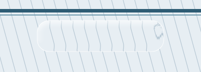

# Magpie Android 2.0 预览 2

底栏的选中块随入口滑动。点按按钮会短暂收缩，松开时回弹。打开和返回详情时，内容沿横向移动。切换底栏入口时，内容从下方向上就位。

在 Android 13 及以上，顶部栏和底栏各自取样背后的内容。滚动列表时可以看到文字和分隔线经过玻璃边缘。Android 12 使用背景模糊，Android 9–11 使用带边缘高光的材质。

在「设置 → 辅助功能」开启「减少动态效果」可停用选择块和页面的位移，静态折射继续显示。「降低透明度」使用实色表面。

## 验收

- 20 个 JVM 测试入口和 API 28 库链接检查通过。玻璃能力测试覆盖 72 种设备和设置组合。
- 使用 Skia 编译生产 AGSL，验证两种背景色下的边缘折射、中心采样和高光。修正前的边缘偏移无法通过加宽色带的用例。
- ARM64 和 x86_64 APK 都完成签名、ABI、16 KB ZIP 对齐和完整公开下载校验。两套包使用相同的 DEX，并沿用此前的签名、Magpie 核心 v0.1.4342 和 Bun 1.4.2。

下面的色带动画由发布包中的 AGSL 在 Skia 上渲染，展示边缘取样怎样改变经过的直线。

[GitHub 发布页](https://github.com/yvichyi/magpieA-/releases/tag/v2.0.0-preview2) · [下载校验值](https://raw.githubusercontent.com/yvichyi/magpieA-/c8b7ded550a92c80501fb042bc0c424730adca28/SHA256SUMS.txt)
