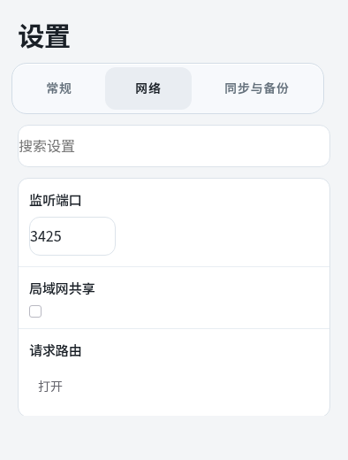
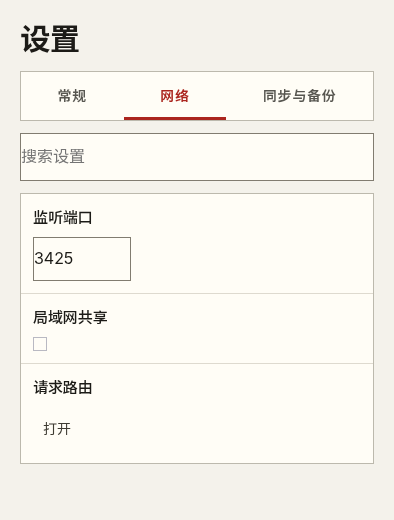

# Magpie Android 2.0 预览 3

在右上角打开「设置」，选择「外观 → 界面主题」即可切换。主题保存在本机。返回后仍在原来的功能入口，模型搜索和用量条件会带过去。

**液态玻璃**使用建筑摄影的局部裁切。石材的明暗线位于顶部栏和底栏背后，经过玻璃边缘时可以被取样。正文和主要数据区保持均匀底色。

**瑞士风格**使用暖白纸面、深色无衬线字、直角控件和红色选中标记。底栏平直贴边，标题、表格和控件沿同一网格对齐。深色模式使用相应的纸面和高对比文字。

## 内嵌管理页主题样例

以下为 Chromium 使用发布包内同一套样式渲染的设置测试页。

| 液态玻璃 | 瑞士风格 |
| --- | --- |
|  |  |

预览 3 的建筑素材由 Vitalii Onyshchuk 拍摄，按 Unsplash License 使用，经裁切和灰阶调色后随该版 APK 离线分发。[照片原页](https://unsplash.com/photos/curving-architectural-lines-with-dramatic-light-and-shadow-XNQ__uum8DM) · [许可](https://unsplash.com/license) · [预览 3 包内素材](https://github.com/yvichyi/magpieA-/blob/v2.0.0-preview3/android/res/drawable-nodpi/architectural_light.webp)

瑞士主题的网格和字阶参考 Poster House 的展览资料与瑞士国家图书馆资料。[The Swiss Grid](https://www.posterhouse.org/exhibition/the-swiss-grid) · [The International Style](https://www.nb.admin.ch/en/the-international-style-1950-1970)

## 验收

21 个 JVM 测试入口通过，包含主题默认值、深浅色对比度和输入框描边。25 项 Chromium 测试覆盖内嵌页样式、深浅配色、设置操作和既有安全回归。ARM64 和 x86_64 完成签名、架构、资源和公开下载校验。

独立 Android 15 模拟器在安装阶段超时。主题切换的设备端验收仍待完成。内置核心为 v0.1.4342。

[GitHub 发布页](https://github.com/yvichyi/magpieA-/releases/tag/v2.0.0-preview3)
