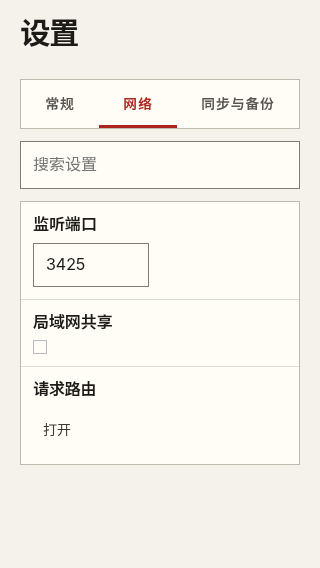

# Magpie Android 2.0 预览 4

接入页分开标签、配置值和复制操作。模型目录把名称、标识和状态排成独立文字层，详情可复制完整标识。用量数字使用等宽数字，两列空间不足时会改成上下排列。插件和设置使用相同的字阶规则。

## 内嵌设置排版

以下是同一个 320px 设置测试页在 Chromium 中使用两个发布版本的样式与字体渲染的截图。

| 预览 3 | 预览 4 |
| --- | --- |
|  |  |

[GitHub 发布页](https://github.com/yvichyi/magpieA-/releases/tag/v2.0.0-preview4)
