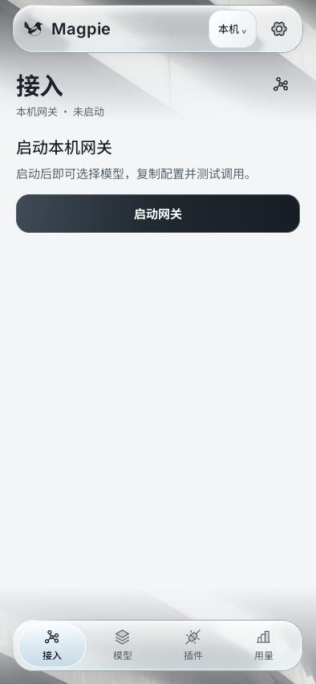
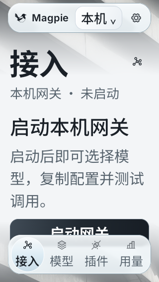
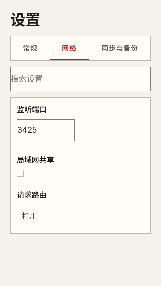

# Magpie Android 2.0 预览 4

接入页分开标签、配置值和复制操作。模型目录把名称、标识和状态排成独立文字层，详情可复制完整标识。用量数字使用等宽数字，两列空间不足时会改成上下排列。插件和设置使用相同的字阶规则。

## 安卓界面

Android 13 模拟器运行签名发布包时截取，工作区尚未接入服务商。

| 394dp，默认字号 | 320dp，双倍字号 |
| --- | --- |
|  |  |

- 默认字号 [模型](normal/02-models.png) · [插件](normal/03-plugins.png) · [用量](normal/04-usage.png) · [设置](normal/05-settings.png)
- 窄屏双倍字号 [模型](large/02-models.png) · [插件](large/03-plugins.png) · [用量](large/04-usage.png) · [设置](large/05-settings.png)
- 瑞士风格 [模型](swiss/02-swiss-models.png) · [插件](swiss/03-swiss-plugins.png) · [用量](swiss/04-swiss-usage.png) · [设置](swiss/05-swiss-settings.png)

## 内嵌设置排版

以下是同一个 320px 设置测试页在 Chromium 中使用两个发布版本的样式与字体渲染的截图。

| 预览 3 | 预览 4 |
| --- | --- |
|  |  |

## 验收

- Android 13 模拟器从签名的 x86_64 发布包安装，安装后的 APK 校验值与下载包一致。
- 默认宽度及 320dp、双倍字号下均通过五页导航和原生组件断言。长模型名与标识各自限行，屏幕阅读器可读完整标识。用量组件在空间不足时切为纵向，文字区域留有间隔。窄屏双倍字号下个别筛选标签会换行。
- 液态玻璃与瑞士风格双向切换通过，模型搜索词保留。此轮原生检查覆盖排版与主题，使用未接入服务商的工作区。
- 26 项 Chromium 检查和 JVM 测试通过。ARM64 和 x86_64 的签名、版本、16 KB 对齐、内置核心及完整下载均完成校验。覆盖升级需使用相同签名的旧版。

[GitHub 发布页](https://github.com/yvichyi/magpieA-/releases/tag/v2.0.0-preview4)
