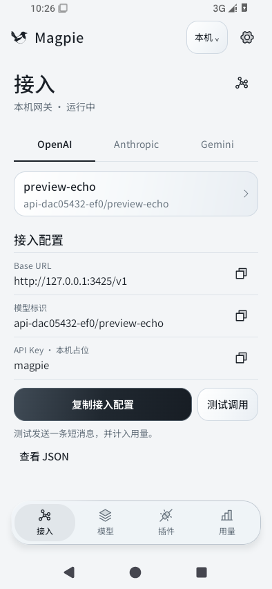
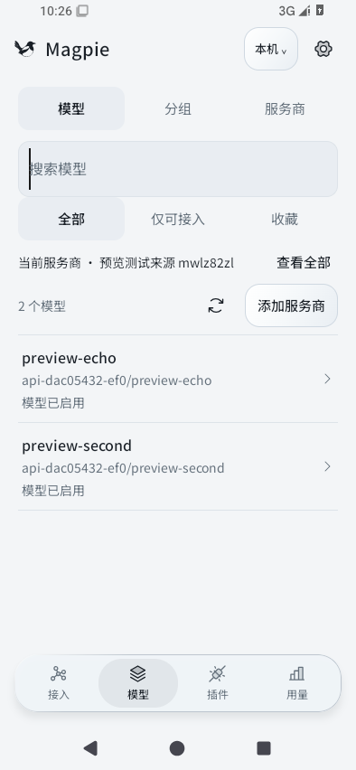
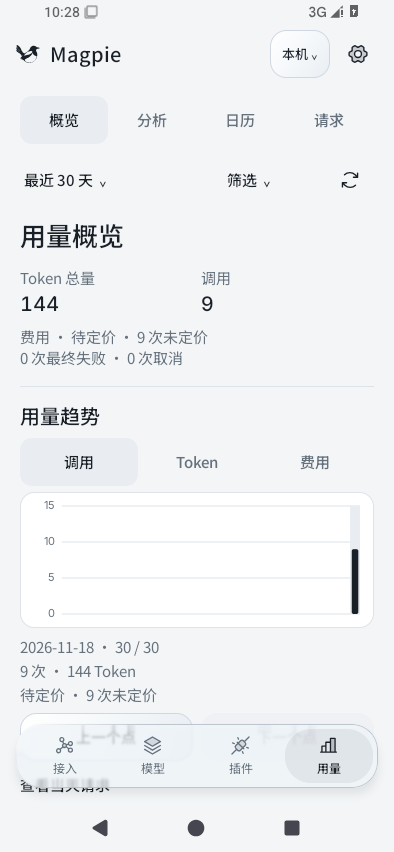
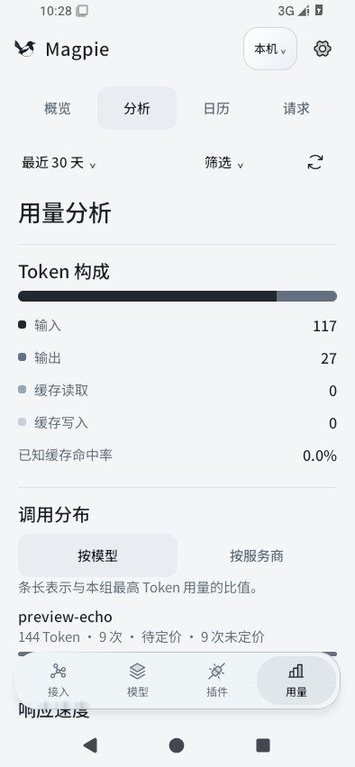
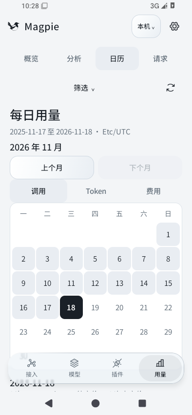
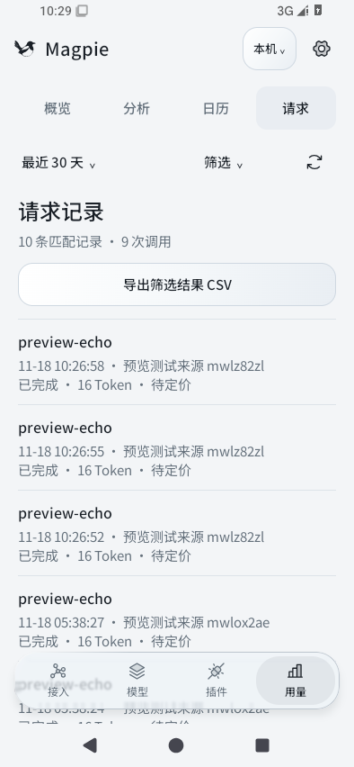
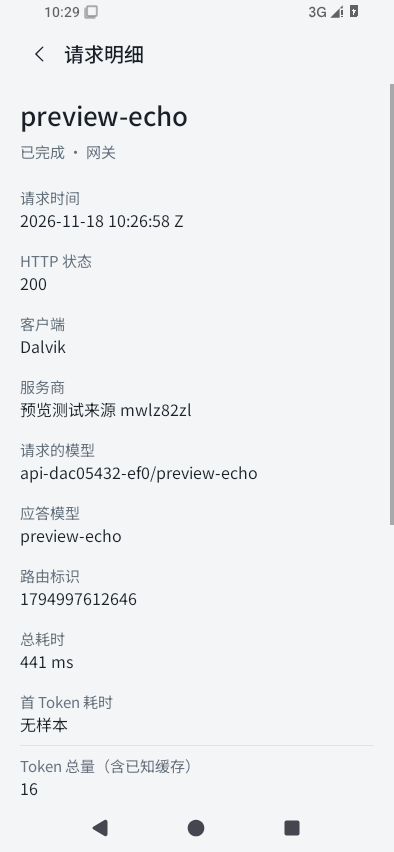
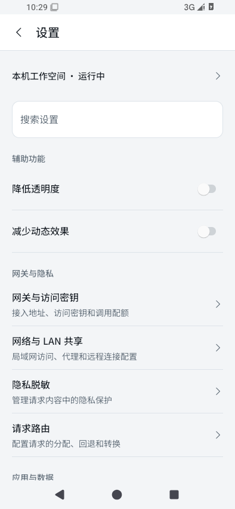

# Magpie Android 2.0 页面实拍

截图来自 Android 15 模拟器运行的 2.0.0-preview1。服务商、插件和用量是验收时经由内置网关生成的测试数据。

| 接入 | 模型 | 插件 |
| --- | --- | --- |
|  |  |  |
| [测试调用](normal/05-connection-test.png) | [添加服务商](normal/01-provider-setup.png) · [模型详情](normal/03-model-detail.png) | [插件入口](normal/08-plugins.png) · [插件详情](normal/10-plugin-detail.png) · [更新完成](normal/11-plugin-updated.png) |
| | [新建分组](normal/06-group-create.png) · [分组成员](normal/07-group-detail.png) | |

| 用量概览 | 用量分析 | 日历 |
| --- | --- | --- |
|  |  |  |

| 请求记录 | 请求明细 | 设置 |
| --- | --- | --- |
|  |  |  |

[安装包](https://github.com/yvichyi/magpieA-/releases/tag/v2.0.0-preview1) · [验证记录](VERIFICATION.md)
